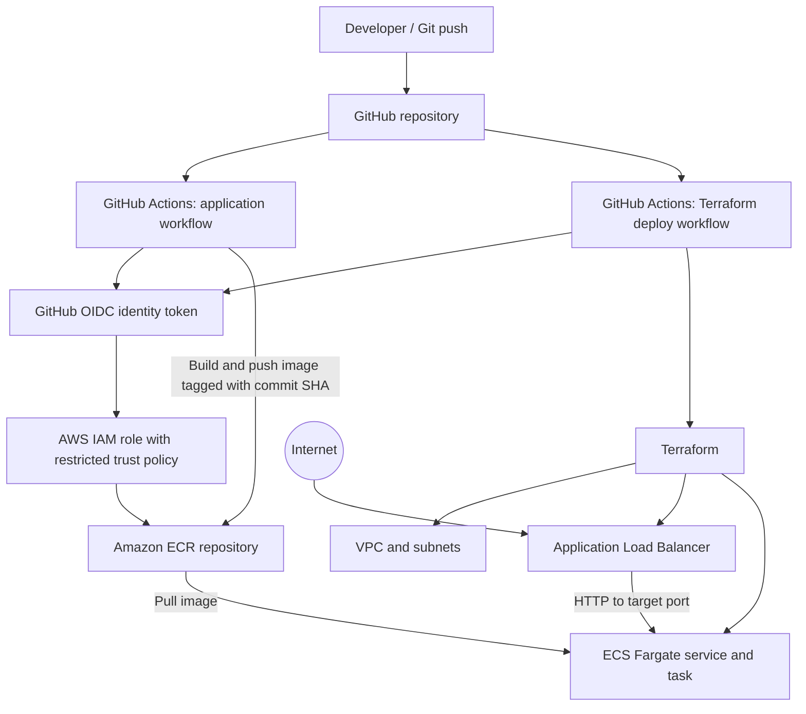
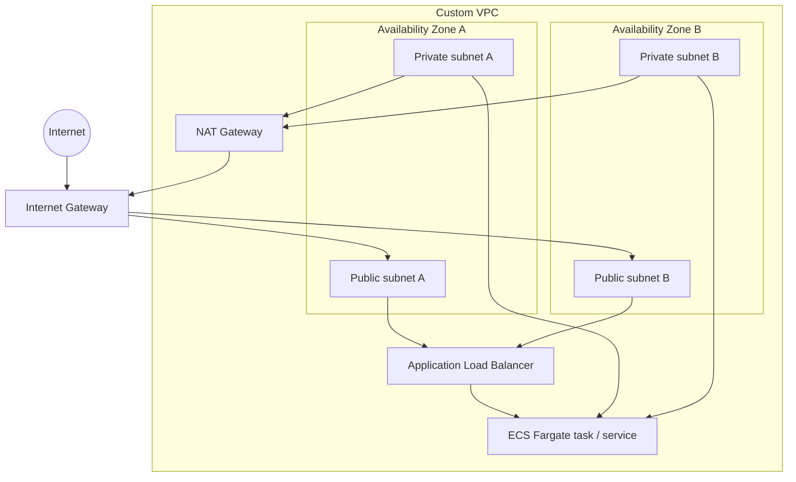

# FocusFlow — Pomodoro Timer on AWS ECS Fargate

A containerized Pomodoro timer application built with HTML, CSS, and JavaScript, packaged with Docker and designed to run on Amazon ECS Fargate. The infrastructure is defined with Terraform, and GitHub Actions workflows are provided for application builds and infrastructure deployment.

> **Project status:** Starter project / in progress. Validate the Terraform configuration and review the AWS plan before deploying. The architecture described below is the intended deployment design; do not assume every optional production feature (such as a custom domain and HTTPS certificate) is configured until it has been implemented and tested.

## Table of contents

- [Features](#features)
- [Architecture](#architecture)
- [Technology stack](#technology-stack)
- [Repository structure](#repository-structure)
- [Run locally with Docker](#run-locally-with-docker)
- [Configure AWS CLI](#configure-aws-cli)
- [Terraform workflow](#terraform-workflow)
- [GitHub Actions and OIDC](#github-actions-and-oidc)
- [Deployment overview](#deployment-overview)
- [Custom domain and HTTPS](#custom-domain-and-https)
- [Cost and security notes](#cost-and-security-notes)
- [Troubleshooting](#troubleshooting)
- [Cleanup](#cleanup)
- [Roadmap](#roadmap)

## Features

- Pomodoro-style focus timer in a lightweight web interface.
- Docker image served by Nginx.
- Terraform modules for the core AWS resources.
- Amazon ECR as the container image registry.
- Amazon ECS on AWS Fargate for managed container compute.
- Application Load Balancer (ALB) to route HTTP traffic to the ECS service.
- GitHub Actions workflow templates for building/pushing the image and managing infrastructure.
- GitHub Actions OIDC as the intended approach for short-lived AWS credentials (rather than storing long-lived AWS access keys in GitHub).
- Designed for the `us-east-1` (US East — N. Virginia) AWS Region by default; confirm the configured region before deployment.

## Architecture

### High-level flow



### Intended network layout

The intended production-style network design uses a custom VPC across two Availability Zones:



**Networking notes**
- The ALB is intended to be internet-facing and placed in public subnets.
- ECS tasks should run in private subnets and receive inbound application traffic only from the ALB security group.
- A NAT Gateway allows private-subnet workloads to initiate outbound connections when required. A single NAT Gateway is cheaper than one per Availability Zone but is not highly available and still incurs hourly and data-processing charges.
- Confirm the actual subnet routing, task placement, security-group rules, and NAT configuration in Terraform before deployment.

### Traffic path

1. A visitor opens the ALB DNS address in a browser.
2. The ALB listener forwards traffic to a healthy target in the ECS service.
3. ECS Fargate runs the container image pulled from ECR.
4. Nginx serves the static web application from the container.

## Technology stack

| Area | Technology |
|---|---|
| Front end | HTML, CSS, JavaScript |
| Web server | Nginx |
| Containerization | Docker |
| Container registry | Amazon ECR |
| Container runtime | Amazon ECS with AWS Fargate |
| Networking | Amazon VPC, public/private subnets, Internet Gateway, NAT Gateway |
| Load balancing | Application Load Balancer |
| Infrastructure as Code | Terraform |
| CI/CD | GitHub Actions |
| CI/CD authentication target | GitHub OIDC + AWS IAM role |
| Default region | `us-east-1` |

## Repository structure

```text
yash-ecs-pomodoro/
├── app/
│   ├── index.html
│   ├── css/
│   │   └── style.css
│   ├── js/
│   │   └── app.js
│   ├── Dockerfile
│   └── nginx.conf
├── infra/
│   ├── main.tf
│   ├── variables.tf
│   ├── outputs.tf
│   ├── versions.tf
│   ├── terraform.tfvars.example
│   └── modules/
│       ├── alb/
│       ├── ecr/
│       ├── ecs/
│       ├── iam/
│       ├── network/
│       └── security/
├── scripts/
│   └── check-local.ps1
├── .github/
│   └── workflows/
│       ├── application.yml
│       ├── terraform-deploy.yml
│       └── terraform-destroy.yml
├── .gitignore
├── PROJECT-REVIEW.md
└── README.md
```

## Run locally with Docker

### Prerequisites

Install and start:
- Git for Windows
- Docker Desktop for Windows (wait until the Docker engine is running)
- AWS CLI v2
- Terraform CLI

You do not need to create an EC2 instance to run ECS Fargate. Docker Desktop is used here for local development and testing.

### 1. Open the project folder

Open PowerShell in the root of this repository (the folder containing `app`, `infra`, and `.github`).

### 2. Build the image

```powershell
docker build -t focusflow:local .\app
```

### 3. Start the container

```powershell
docker run --name focusflow-local -p 8080:80 -d focusflow:local
```

### 4. Open the app

Visit [http://localhost:8080](http://localhost:8080).

### 5. Check container status and logs

```powershell
docker ps
docker logs focusflow-local
curl.exe -i http://localhost:8080/
```

The Nginx configuration must listen on **port 80 inside the container** for the mapping `-p 8080:80` to work. In `app/nginx.conf`, confirm that the server block contains:

```nginx
listen 80;
```

If you change the Dockerfile, Nginx config, or application files, rebuild and recreate the container:

```powershell
docker build --no-cache -t focusflow:local .\app
docker rm -f focusflow-local
docker run --name focusflow-local -p 8080:80 -d focusflow:local
```

If the container does not exist, `docker rm -f focusflow-local` may report an error; you can ignore that specific message and run the `docker run` command after the build succeeds.

### Stop and remove the local container

```powershell
docker stop focusflow-local
docker rm focusflow-local
```

## Configure AWS CLI

Set the desired default region:

```powershell
aws configure set region us-east-1
aws configure get region
```

Verify the identity being used:

```powershell
aws sts get-caller-identity
```

A successful response includes the AWS account ID and ARN. If the command says it cannot locate credentials, configure an approved authentication method first.

**Credential safety**
- Never commit AWS access keys, secret keys, session tokens, passwords, or `.tfstate` files to Git.
- Do not use root-user access keys.
- For local development, use an appropriately permissioned IAM identity or your organization's approved SSO approach.
- For GitHub Actions, prefer OIDC federation and short-lived credentials instead of long-lived IAM user keys.

## Terraform workflow

> Run these commands from the repository root unless a command explicitly changes directory. Do not run `terraform apply` until the plan has been reviewed and you understand the cost of the resources.

### 1. Enter the infrastructure directory

```powershell
cd .\infra
```

### 2. Format and initialize

```powershell
terraform fmt -recursive
terraform init
```

### 3. Validate the configuration

```powershell
terraform validate
```

### 4. Create a local variables file

Review `terraform.tfvars.example`. If required by the variables in this project, create your own `terraform.tfvars` and fill in appropriate values:

```powershell
Copy-Item .\terraform.tfvars.example .\terraform.tfvars
```

Do not commit your private `terraform.tfvars` file if it contains account-specific or sensitive values. The repository `.gitignore` should exclude local Terraform state and private variable files.

### 5. Review the execution plan

```powershell
terraform plan -out=tfplan
terraform show tfplan
```

Review every resource and the expected monthly costs. The plan may need adjustments depending on your AWS account, permissions, quotas, region, and the features configured in the Terraform files.

### 6. Apply only after reviewing

```powershell
terraform apply tfplan
```

Do not run this until the configuration validates and you are ready for billable resources. Save any output values needed by later steps, but do not publish sensitive outputs.

### 7. Review outputs

```powershell
terraform output
```

Return to the repository root when finished:

```powershell
cd ..
```

## GitHub Actions and OIDC

The `.github/workflows/` folder contains workflow templates for:
- `application.yml` — build and publish the container image to ECR.
- `terraform-deploy.yml` — run Terraform deployment steps.
- `terraform-destroy.yml` — run Terraform destroy steps.

Before enabling these workflows, inspect each YAML file and update all placeholder values. Do not assume the workflows are ready for production without validating their permissions, triggers, branch restrictions, and Terraform state handling.

### OIDC setup checklist

1. Create/configure the GitHub OIDC identity provider in AWS IAM for `token.actions.githubusercontent.com` if your account does not already have one.
2. Create an IAM role for GitHub Actions.
3. Restrict the role trust policy to the exact GitHub organization/user and repository, and preferably the intended branch or GitHub environment.
4. Grant only the AWS permissions required for ECR publishing and the Terraform resources being managed.
5. In the workflow, grant the job `id-token: write` and the minimum required repository permissions.
6. Use `aws-actions/configure-aws-credentials` with the IAM role ARN and region.
7. Configure the required non-secret repository variables or GitHub Environment values (for example, AWS region, ECR repository name, and role ARN) as referenced by the actual workflow files.
8. Test the workflow on a non-production branch and inspect the logs.

Do not paste your AWS secret access key into GitHub repository files or workflow YAML. The application workflow should tag images immutably (for example, using the Git commit SHA) and deploy the intended tag.

## Deployment overview

A typical deployment sequence is:

1. Verify local tools and AWS identity.
2. Build and test the app locally with Docker.
3. Validate and review Terraform.
4. Configure GitHub repository variables and AWS OIDC trust.
5. Deploy the infrastructure and create the ECR repository.
6. Build and push the image to ECR through GitHub Actions.
7. Update the ECS task/service to use the pushed image.
8. Verify the ALB health checks and open the ALB DNS name.
9. Check CloudWatch logs and ECS service events if the target is unhealthy.

The exact ordering depends on how the current workflows are written. Review their dependencies before running them.

## Custom domain and HTTPS

A custom domain and a trusted public HTTPS certificate require control of a domain and DNS validation.

- Without a domain, use the ALB DNS name for initial testing over HTTP if the Terraform configuration supports it.
- To enable HTTPS with AWS Certificate Manager (ACM), obtain a domain, request a certificate in the same region as the ALB, complete DNS validation, and configure an HTTPS listener.
- Route 53 is optional if you manage DNS with another provider; the required DNS records must still be created with that provider.
- Do not add a fake domain or copy another project's domain, AWS account ID, IAM role ARN, or state bucket name.

## Cost and security notes

This project can create billable AWS resources. Charges may continue even when the website receives no traffic.

Potential cost sources include:
- NAT Gateway hourly and data-processing charges.
- Application Load Balancer hourly and capacity-unit charges.
- ECS Fargate CPU and memory while tasks run.
- ECR image storage.
- CloudWatch logs and metrics.
- Public IPv4 addresses and data transfer where applicable.
- Route 53 hosted zones and domain registration if added later.

Cost-control recommendations:
- Start with one Fargate task for a learning environment.
- Understand that one NAT Gateway is cheaper but creates an availability trade-off.
- Review `terraform plan` before applying.
- Set an AWS Budget and billing alerts.
- Avoid deploying optional resources until needed.
- Destroy resources when finished testing, and verify in the AWS Console that billable resources were removed.

Security recommendations:
- Keep ECS tasks in private subnets when the network design supports it.
- Allow inbound application traffic to the tasks only from the ALB security group.
- Use least-privilege IAM policies.
- Use GitHub OIDC rather than persistent AWS keys in GitHub.
- Do not commit secrets, Terraform state, local variable files, or credentials.
- Review the public exposure of the ALB and security groups before deployment.

## Troubleshooting

### `terraform` is not recognized

Confirm Terraform is installed and its containing directory is in the Windows `PATH`. Close and reopen PowerShell after updating PATH, then run:

```powershell
terraform -version
```

### `aws sts get-caller-identity` says credentials cannot be found

Configure an approved AWS CLI authentication method, then retry:

```powershell
aws sts get-caller-identity
```

### Docker returns `ERR_EMPTY_RESPONSE` at `localhost:8080`

Check the container, port mapping, and Nginx configuration:

```powershell
docker ps -a
docker logs focusflow-local
docker port focusflow-local
docker exec focusflow-local nginx -t
docker exec focusflow-local wget -S -O - http://127.0.0.1/
curl.exe -v http://localhost:8080/
```

For `docker run -p 8080:80`, Nginx must listen on port 80 inside the container. If you edit `app/nginx.conf`, rebuild the image and recreate the container.

### ECS target is unhealthy

Check:
- ECS service events and task status.
- CloudWatch logs.
- The container port and ALB target group port.
- The ALB health-check path and expected response.
- Security-group rules between the ALB and ECS tasks.
- Whether the image tag exists in ECR and the task execution role can pull it.

### Terraform initialization or validation fails

Run `terraform init` from `infra/`, then `terraform validate`. Copy the complete error message and inspect the referenced file and line before changing configuration. Do not apply infrastructure while validation errors remain.

## Cleanup

If you deployed resources with Terraform and want to remove them, first review the current state and destroy plan. Run this only when you intend to delete the resources managed by this Terraform configuration:

```powershell
cd .\infra
terraform plan -destroy
terraform destroy
```

Confirm the prompt only after checking what will be removed. Then verify in the AWS Console that the ECS service, ALB, NAT Gateway, and other resources are gone. Data stored outside Terraform's management may require separate cleanup.

## Roadmap

- [ ] Confirm the application works locally through Docker.
- [ ] Validate all Terraform modules and variables.
- [ ] Review and test the AWS deployment plan.
- [ ] Configure least-privilege GitHub OIDC authentication.
- [ ] Publish images to ECR using commit-SHA tags.
- [ ] Deploy and verify the ECS Fargate service behind the ALB.
- [ ] Configure CloudWatch log retention and operational checks.
- [ ] Add a custom domain and ACM HTTPS after obtaining a domain.
- [ ] Test the destroy workflow and verify cost-producing resources are removed.

---

## Author

**Yash Patil**

This project is intended for learning and demonstrating containerization, Infrastructure as Code, AWS networking, ECS Fargate, and CI/CD automation. Update this README as features are implemented and verified.
